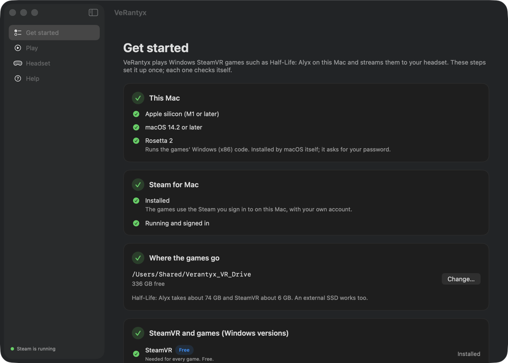
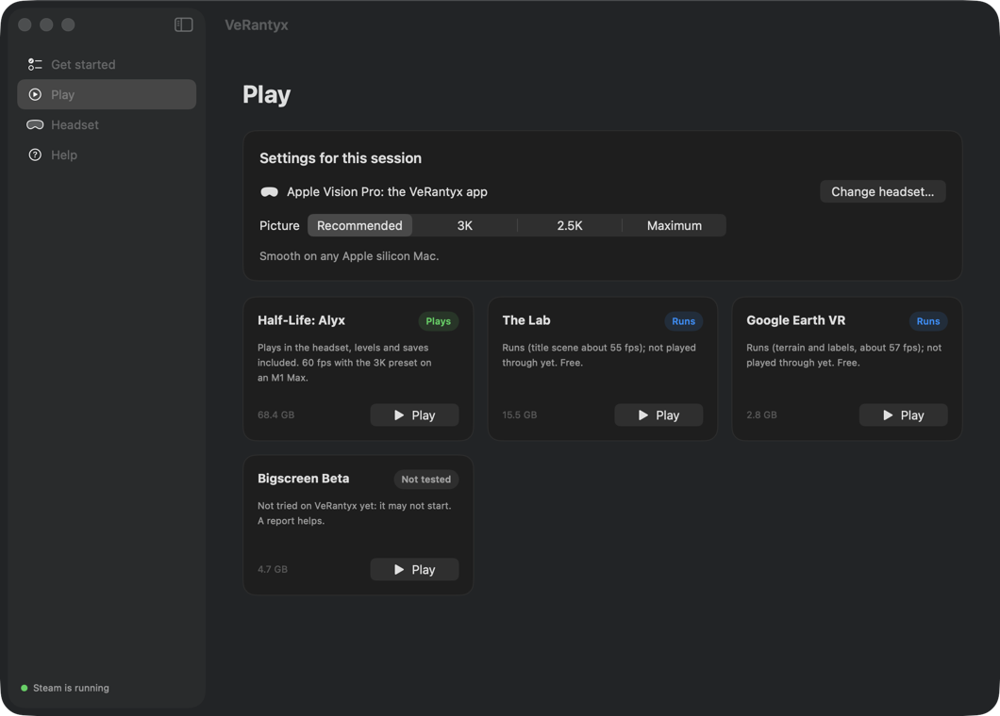
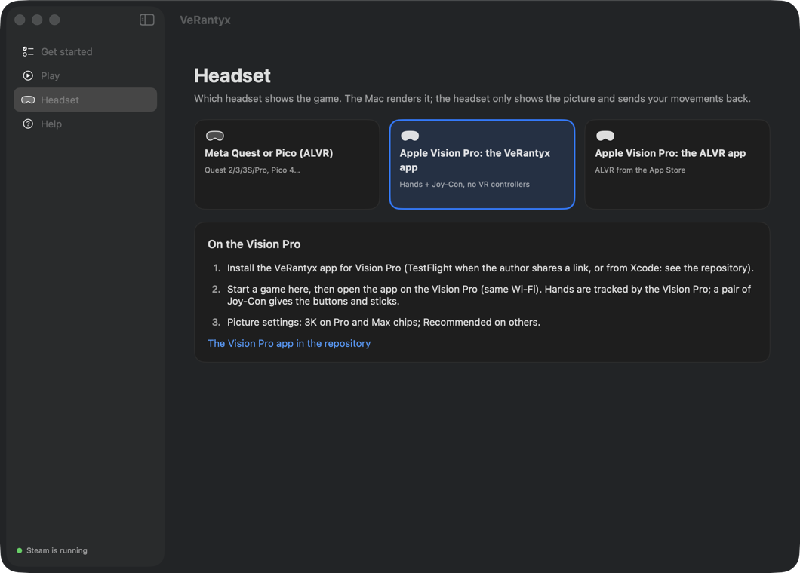

<h1 align="center">VeRantyx</h1>

<b>PC VR on an Apple silicon Mac — no Windows PC, no Wine.</b> 
Windows SteamVR games run on our own Windows runtime and stream to Apple Vision Pro or an ALVR headset.

  
  
  
  

   
  Half-Life: Alyx, Windows build, on a MacBook Pro M1 Max — no Wine. 3K preset, played in Vision Pro with hands + Joy-Con. <a href="https://youtu.be/qF09ETv1TpU">Full 4-minute unedited recording</a>.

  <a href="#get-started">Get started</a> ·
  <a href="#what-runs">What runs</a> ·
  <a href="#under-the-hood">Under the hood</a> ·
  <a href="#branches">Branches</a> ·
  <a href="docs/README_ja.md">日本語</a>

## Get started

1. **[Download VeRantyx for Mac](https://github.com/Ag3497120/VeRantyx/releases/latest)** — signed and notarized by
   Apple. Drag it to Applications. The runtime is inside: you need only macOS and Steam.
2. **Get started** in the app: it checks the Mac, gets SteamVR and your games' Windows builds with *your own* Steam
   account (or copies them from a Steam library you already have), and gathers the Microsoft runtime files from
   their own installers.
3. **Pick your headset and press Play.**

That's it. Details, languages (11) and what is checked: [MacApp/README.md](MacApp/README.md).
Prefer Terminal? `scripts/setup_vxrt.sh` then `scripts/launch_vxrt_alyx.sh` — see [the vxrt guide](docs/VXRT.md#quick-start).

  
  
  

## What runs

| Game | Status on VXRuntime | Measured |
|---|---|---|
| **Half-Life: Alyx** | ✅ Playable — played in the headset across level changes and saves | 60 fps at the 3K preset (1440×1620 per eye), MacBook Pro M1 Max |
| **Google Earth VR** | 🟡 Runs in VR, playtest pending | 56.7 fps, M1 Max |
| **Elite Dangerous** | 🟡 Flies on the Mac's screen and in the headset (official launcher; keyboard, mouse, DualSense) | flat: about 52-122 fps in game; VR: 30-35 fps at 1700×1372 per eye; M1 Max, Low |
| **The Lab** | 🟡 Runs in VR (title scene), playtest pending; its controller bindings load since 0.2.0 | 54.0 fps, M1 Max |
| Other SteamVR games | ⚪ Most still need Windows functions VXRuntime lacks | [games/](games/) has what is known |

Checked on a MacBook Pro M1 Max and a MacBook Air M5. Numbers come from harness runs with their run ids in
[games/](games/). Not supported: Direct3D 12 games (in progress, below), Vulkan, tessellation, anti-cheat (never
worked around).

| Headset | How | Status |
|---|---|---|
| **Apple Vision Pro** (M2 or M5) | VeRantyx app: hand tracking + Joy-Con, or bare hands — **no VR controllers needed** | ✅ Checked |
| **Apple Vision Pro** | "ALVR" app from the App Store | ✅ Checked (Alyx, Earth VR) |
| **Meta Quest, Pico** | ALVR 20.x, Wi-Fi or USB cable | ❔ Not tested yet — [we'd love a report](https://github.com/Ag3497120/VeRantyx/issues/new?template=alvr-headset.yml) |

## Under the hood

Everything below is in this repository, MIT licensed, and was written for this project.

- **VXRuntime — a Windows runtime written from scratch for Apple silicon.** No Wine, no wineserver: a PE loader and
  the Windows API (kernel32, exceptions, files and registry, windows on AppKit, COM, audio on Core Audio) as native
  code that Windows programs call directly. [VXRuntime/](VXRuntime/README.md)
- **Direct3D 11 → Metal in one step.** Our own DXBC → Metal Shading Language translator; geometry shaders and
  stream output run as compute. Alyx went from ~30 fps under Wine (DXVK → MoltenVK) to 60 fps on the same Mac.
- **Direct3D 12 → Metal, from scratch (early).** A DXIL reader with no LLVM, a DXIL → MSL translator and `d3d12.dll`
  on Metal: compute, root signatures, descriptor heaps, graphics pipelines, draws, swap chains, heaps, placed
  resources and GPU queries pass their tests. No D3D12 game runs yet.
- **The real Windows SteamVR on the Mac.** vrserver and vrcompositor run on VXRuntime with our driver; textures cross
  processes as IOSurfaces. Games talk to the **Mac** Steam client through a bridge — no Windows Steam, no Chromium.
- **HEVC streaming.** VideoToolbox HEVC (10-bit at the 3K preset) to our visionOS app, each frame at the exact pose and
  frustum it was rendered for — or through ALVR's own streaming core to ALVR clients, over Wi-Fi or a USB cable.
- **A notarized SwiftUI Mac app** that does the whole setup without Terminal, in 11 languages.
- **Our own x86-64 → ARM64 translator (in progress)** for when Rosetta 2 goes away: Google Earth VR has run on it;
  not used for games by default. [TRANSLATOR.md](VXRuntime/TRANSLATOR.md)
- **Built for AI coding agents.** `/vxrt-support <game>` and `/vxrt-tune <game>` in Claude Code, Codex, Gemini CLI and
  Cursor; a harness that measures runs into evidence (observed values with file hashes, sealed in a hash-chained
  ledger); an MCP server; [Command Clips](VXRuntime/CLIPS.md) to operate Windows programs without screenshots.
  [AGENTS.md](AGENTS.md)

## Branches

| Branch | What it is | For | Status |
|---|---|---|---|
| **[`main`](https://github.com/Ag3497120/VeRantyx)** = [`vxrt`](https://github.com/Ag3497120/VeRantyx/tree/vxrt) | Windows games + real SteamVR on **VXRuntime** | Players (via the app) and developers | ⭐ Current, developed daily — [full guide](docs/VXRT.md) |
| [`native`](https://github.com/Ag3497120/VeRantyx/tree/native) | Valve's **Linux ARM64** Alyx runs natively on macOS (patched Klepton + our OpenVR runtime) | Alyx only; the fastest path, no CPU translation | Kept as of 2026-10-11 |
| [`wine`](https://github.com/Ag3497120/VeRantyx/tree/wine) | Windows build + real SteamVR under **Wine 11**, DXVK → MoltenVK | Reference / history | Kept as of 2026-10-10, ~30 fps |

All Mac-side versions share the HEVC encoder (`MacEncoder/`) and the Vision Pro app (`VisionProClient/`).

## Your games, your copy

No Valve, Microsoft or game files are in this repository or its releases. SteamVR and the games come from your own
Steam account; Microsoft's runtime DLLs are taken from the redistributable installers your own installs carry, on your
Mac only. Licenses: [THIRD_PARTY_NOTICES.md](THIRD_PARTY_NOTICES.md). Not affiliated with Valve, Apple, Microsoft,
Meta, Nintendo, Sony, ALVR, Glovebox or Klepton.

**Help wanted:** a Quest or Pico report (works or not), and game profiles with harness runs as evidence
([games/README.md](games/README.md)). MIT © 2026 Ag3497120.
