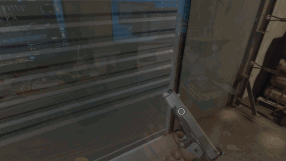
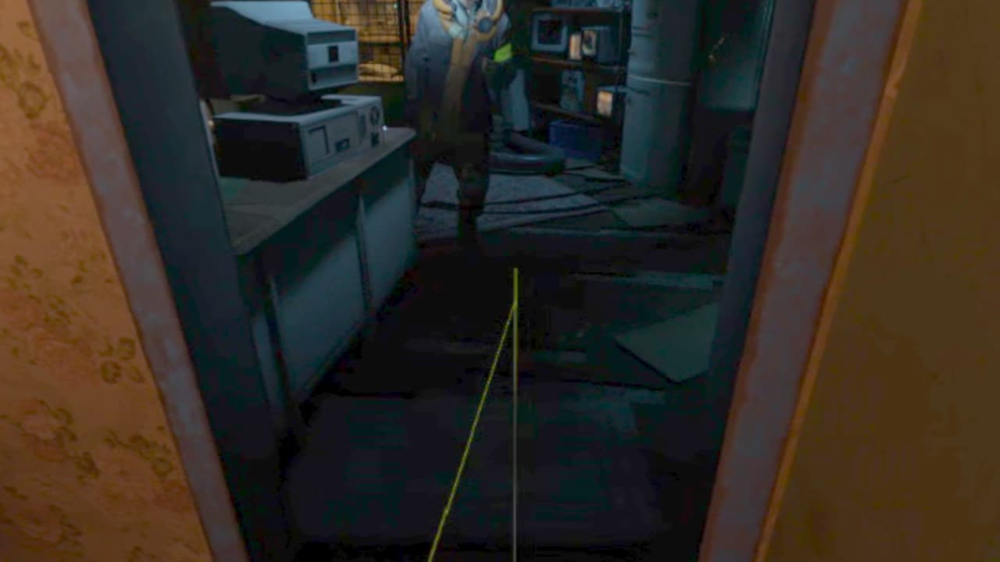
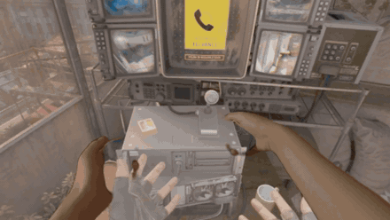
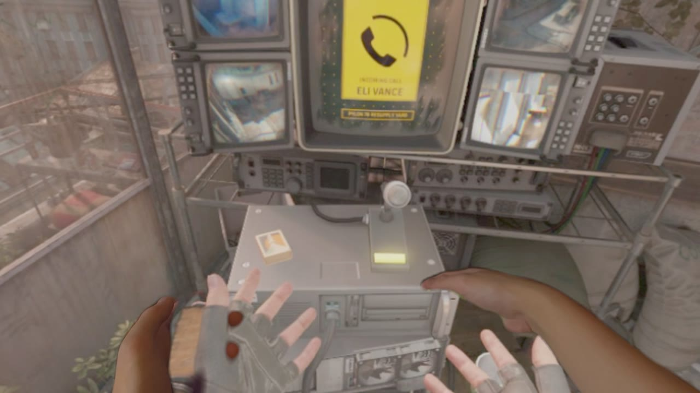

# VeRantyx

**Play PC VR games from an Apple Silicon Mac in an Apple Vision Pro — with your hands and a pair of Joy-Con, no tracked VR controllers.**

VeRantyx renders Half-Life: Alyx on the Mac, streams every stereo frame to a
native visionOS app in hardware-encoded HEVC, and sends the headset's head and
hand poses back. Hands are tracked by the Vision Pro; buttons, sticks and
triggers come from Nintendo Switch Joy-Con (one in each hand), or the game is
played with bare hands. No tracked VR controllers are needed: the PS VR2 Sense
controllers that other Vision Pro ports of Alyx require are not sold in every
region (not in Japan at the time of writing).

There are **three versions**, on their own branches:

| Branch | How the game runs on the Mac | Status |
|---|---|---|
| [`native`](https://github.com/Ag3497120/VeRantyx/tree/native) | Valve's **Linux ARM64** build of Half-Life: Alyx (made for the Steam Frame) runs natively on macOS — no Wine, no Rosetta, no SteamVR — through a patched [Klepton](https://github.com/shinyquagsire23/Klepton) loader, a glibc compatibility layer and an OpenVR runtime of our own | New (2026-10-11). Menu at 60 fps, levels played for 20+ minutes on an M1 Max |
| [`wine`](https://github.com/Ag3497120/VeRantyx/tree/wine) | The Windows build with the real Windows SteamVR under Wine 11, DXVK → MoltenVK, and a SteamVR driver of our own | Stable since 2026-10-10; ~30 fps in game on an M1 Max |
| [`vxrt`](https://github.com/Ag3497120/VeRantyx/tree/vxrt) | The Windows build and the real Windows SteamVR on **[VXRuntime](#the-vxrt-version-vxruntime)** (vxrt), a Windows runtime written from scratch for Apple silicon in this repository — no Wine: Direct3D 11 on Metal, Steam through the Mac Steam client | New (2026-10-13). First chapter at 45–57 fps; 3K preset (1440×1620 per eye) at 36–38 fps on an M1 Max; not yet played in the headset |
| `main` | All of the above | Development |

All versions share the Mac HEVC encoder (`MacEncoder/`) and the Vision Pro
app (`VisionProClient/`).

### Native version (Linux ARM64 build, no Wine) — recorded 2026-10-11



[](https://youtu.be/2z-GyAqAtpA)

*Native version, 48-second highlight: [docs/media/native-highlight.mp4](docs/media/native-highlight.mp4).
The Joy-Con it is played with (seen through the passthrough), hands and fingers
in Russell's lab, gravity gloves (pulling and catching a helmet), then
reloading the pistol. 60 fps on an M1 Max. Full 6-minute unedited recording of the native version: https://youtu.be/2z-GyAqAtpA.*

### Wine version (Windows build + SteamVR under Wine) — recorded 2026-10-10

<!-- VIDEO: after uploading docs/media/highlight.mp4 through the README editor
     on github.com, replace the poster link below with the generated
     https://github.com/user-attachments/... URL on its own line; GitHub then
     renders a player. -->


[](https://youtu.be/6xVGgdChDes)

*Wine version, 54-second highlight: [docs/media/highlight.mp4](docs/media/highlight.mp4) — the last seconds show the room through the Vision Pro's passthrough, where it was recorded. Full 6-minute unedited recording of the Wine version: https://youtu.be/6xVGgdChDes.*

MIT licensed. No proprietary code is included (see
[THIRD_PARTY_NOTICES.md](THIRD_PARTY_NOTICES.md)): Wine, DXVK and Steam are
downloaded from their publishers by the setup script, SteamVR and the game
come from your own Steam account, and Apple's Game Porting Toolkit is neither
used nor shipped.

## Why VeRantyx

- **No tracked VR controllers.** Vision Pro hand tracking gives the hands'
  position; Joy-Con gyro and accelerometer are fused in for fast motion and
  for when a hand leaves the cameras' view, and the grip pose is carried from
  the wrist while a Joy-Con hides the knuckles. Gravity gloves, grabbing,
  pinch-to-trigger and finger animation (native version) all work without
  PS VR2 Sense controllers.
- **Any Vision Pro.** The game renders on the Mac's GPU, so a first-generation
  (M2) Vision Pro plays the same as a new one; the headset only decodes and
  displays.
- **Your own copy, nothing redistributed.** The game, SteamVR (Wine version)
  and Steam come from your own Steam account; this repository contains no
  Valve or Apple code apart from Valve's BSD-licensed OpenVR headers.
- **Native ARM version, no emulation.** Valve's own ARM64 Linux build runs on
  Apple Silicon directly, with a small OpenVR runtime instead of SteamVR:
  the menu holds 60 fps where the Wine version managed ~30, shader compiles
  run off the render thread, and game audio plays through Core Audio.
- **Accurate image.** Each eye is drawn at the exact frustum the game rendered
  with, and every frame carries the head pose it was rendered for, so the
  headset reprojects correctly.
- **Open source, MIT.** Every part — Mac launcher, glibc layer, OpenVR runtime,
  encoder, visionOS app — is in this repository and can be read and rebuilt.

## Built on

| Project | Used for | License | In this repository? |
|---|---|---|---|
| [Klepton](https://github.com/shinyquagsire23/Klepton) by ShinyQuagsire | Native version: loading Valve's ARM64 ELF libraries on macOS, its bionic libc and Vulkan-on-MoltenVK runtime; our patch set adds glibc TLS, x18 and loader fixes, CPU topology, asynchronous pipelines (`NativeARM/klepton-patches/`) | MIT | No — fetched by `NativeARM/scripts/fetch_klepton.sh`, patched by `apply.py` |
| [MoltenVK](https://github.com/KhronosGroup/MoltenVK) | Vulkan → Metal (both versions; Wine version via DXVK) | Apache-2.0 | No (Klepton's build / DXVK) |
| Valve's Half-Life: Alyx (Linux ARM64 depot 546564, Windows build) | The game | Valve's terms | No — your own Steam account |
| Valve's [OpenVR SDK headers](https://github.com/ValveSoftware/openvr) | SteamVR driver, capture proxy, native OpenVR runtime | BSD-3-Clause | Yes (`VRDriver/include/`, `NativeARM/vrruntime/openvr/`) |
| [ALVR](https://github.com/alvr-org/ALVR) | OpenVR hand-skeleton bone poses for finger animation (native version) | MIT | Yes, unchanged data with its license (`NativeARM/vrruntime/hand_skeleton_alvr.inc`) |
| [Fossilize](https://github.com/ValveSoftware/Fossilize) | Optional shader-prewarm experiment (not used by the launcher) | MIT | No — fetched by `NativeARM/scripts/build_fossilize.sh` |
| Debian trixie arm64 packages | glib, libstdc++, ssl, png … the Linux libraries the game expects from the Steam Linux Runtime | various (DFSG) | No — fetched by `NativeARM/scripts/fetch_debian_libs.sh` |
| Wine Staging (Gcenx build), DXVK for macOS (Gcenx) | Wine version | LGPL-2.1, zlib | No — fetched by `scripts/setup.sh` |

Details: [THIRD_PARTY_NOTICES.md](THIRD_PARTY_NOTICES.md).

## The vxrt version: VXRuntime

### What vxrt is

VXRuntime ("vxrt", in [`VXRuntime/`](VXRuntime/)) is a Windows compatibility
layer written from scratch for Apple silicon Macs. It loads Windows programs
(PE files) and gives them the Windows API they call, implemented directly on
macOS: files, the registry, threads and synchronization, exceptions, windows
and input on AppKit, sockets, COM, audio on Core Audio, and Direct3D 11 / DXGI
on Metal. With it, the Windows build of Half-Life: Alyx and the real Windows
SteamVR (vrserver, vrcompositor and the VeRantyx driver) run on the Mac without
Wine, and the game reaches the Steam client you already run on macOS.

It was started on 2026-10-12 because Wine was the bottleneck of the Wine
version (the Mac was CPU-bound at ~30 fps, with wineserver, Steam's Chromium
and two layers of graphics translation all on the CPU) and because Wine's own
design blocked Apple's D3DMetal. vxrt runs the Windows build, so it is not
tied to a game having a Linux ARM64 build (Alyx is the only SteamVR title with
one, made for the Steam Frame).

### How it is built

```
 One macOS x86-64 process per Windows process (Rosetta 2 translates both together)
 ┌────────────────────────────────────────────────────────────────────────────┐
 │ hlvr.exe, vrcompositor.exe, ... (unchanged Windows PE code)                │
 │   │ calls Windows functions directly (ms_abi), no Unix/PE boundary         │
 │   ▼                                                                        │
 │ vxrt: PE loader · kernel32/ntdll · SEH and C++ exceptions · files/registry │
 │       user32/gdi on AppKit and Core Graphics · ws2_32 · COM · winmm/WASAPI │
 │       Direct3D 11/DXGI on Metal (DXBC → Metal Shading Language)            │
 │       shared textures (IOSurface + keyed mutex) across processes           │
 │       Steam bridge → the Mac Steam client's steamclient.dylib              │
 └────────────────────────────────────────────────────────────────────────────┘
```

- **No Unix half.** In Wine a Windows API call crosses from PE DLLs into a
  separate Unix side, and kernel objects shared between processes go through
  wineserver. In vxrt the Windows API is native Mach-O code with the Windows
  calling convention, called by the program directly; kernel objects live in
  the process, and only named objects other processes need are put in shared
  memory.
- **Thread state as macOS has it.** `gs` stays macOS's thread-specific data;
  the TEB pointer and TLS array are written into two of its slots, so Windows
  code, the runtime and Metal share a thread without switching anything.
- **Graphics straight to Metal.** Direct3D 11 calls become Metal calls, and
  shaders are translated from DXBC to Metal Shading Language once (in the
  background, cached by Metal). The Wine version went D3D11 → Vulkan (DXVK) →
  Metal (MoltenVK). Geometry shaders run as compute kernels; textures shared
  between the game, the compositor and the driver are IOSurfaces with keyed
  mutexes, so SteamVR's compositor accepts the game's frames directly (under
  Wine it could not open them).
- **Steam without Windows Steam.** The game's `steamclient64.dll` is a
  built-in that forwards every Steam interface to the Mac Steam client you are
  signed in to (static ms_abi → System V stubs per interface method), so no
  Windows Steam and no Chromium run.
- **No code made at run time.** Method tables and call stubs are generated
  ahead of time or written in assembly; Valve's and Microsoft's files are used
  from your own installation and never shipped.
- **Built milestone by milestone**, each a small Windows program that has to
  run unchanged (`make check`, 20 test programs): PE loader and kernel32 →
  threads and exceptions → files and DLLs → windows on AppKit → COM, I/O
  completion ports, MSVC C++ exceptions → Direct3D 11 on Metal → compute,
  input, audio → processes and shared textures (SteamVR) → the Steam bridge
  (Alyx) → geometry shaders → the 3K/10-bit work. About 21,600 lines of C and
  Objective-C, written in two days (2026-10-12 and 13) with Claude Opus 5.5 in
  Claude Code. Design notes, every milestone and its test:
  [VXRuntime/README.md](VXRuntime/README.md).

### Compared with the Wine and native versions

Half-Life: Alyx, MacBook Pro M1 Max, measured with each version's own logs.

| | Wine version | Native version | vxrt version |
|---|---|---|---|
| Game build | Windows (x86-64) | Linux ARM64 (Steam Frame build) | Windows (x86-64) |
| CPU code | Rosetta 2 + Wine | Native ARM64 (no translation) | Rosetta 2, no Wine |
| VR runtime | Real SteamVR under Wine | Our own OpenVR runtime | Real SteamVR on vxrt |
| Graphics | D3D11 → DXVK → Vulkan → MoltenVK → Metal | Vulkan → MoltenVK → Metal | D3D11 → Metal (own translator) |
| Steam | Windows Steam + Chromium under Wine | Mac Steam client | Mac Steam client (bridge) |
| In game, default size | ~30 fps (CPU-bound, SteamVR scale 0.7) | 60 fps, 1298×1056 per eye | 45–57 fps, ~840×940 per eye |
| Larger sizes | — | 1982×1536 per eye ~39 fps; ~3K per eye ~20 fps | 1440×1620 per eye 36–38 fps (72 Hz); stream 2880×1620 HEVC Main10 |
| Other Windows VR games | Possible (Wine) | No: needs a Linux ARM64 build | Possible in principle; only Alyx and SteamVR Home tested |
| Played in the headset | Yes | Yes (20+ min sessions) | Not yet |

In short: the native version is the fastest (no CPU translation) but exists
only because Valve made an ARM64 Alyx; the Wine version runs any Windows game
but pays for Wine and double graphics translation; vxrt keeps the Windows build
and the real SteamVR while removing Wine, and is the one we can optimize down
to every call. It is a research project: Direct3D 12, tessellation and stream
output are not there yet, and it has only been tested with Alyx and SteamVR.

### Running the vxrt version

Steam running on the Mac and signed in, SteamVR and the game installed in a
Windows Steam library (the Wine version's prefix is read, never written):

```bash
make -C VXRuntime check                          # builds vxrt and runs its tests
scripts/launch_vxrt_alyx.sh                      # SteamVR on vxrt + encoder + Half-Life: Alyx
VXRT_VR_QUALITY=3k scripts/launch_vxrt_alyx.sh   # 1440×1620 per eye, 2880×1620 10-bit HEVC at 40 Mbps, 72 Hz
```

The first start compiles the game's shaders (a few minutes). The 10-bit stream
needs the current Vision Pro app (`scripts/deploy_vision_pro_app.sh`).

## Compared with Glovebox

[Glovebox](https://glovebox.vision/) (Udi Wertheimer, October 2026) also runs
Valve's Linux ARM64 build of Alyx through Klepton, but on the Vision Pro
itself. Both are open source and use your own copy of the game.

| | VeRantyx (native branch) | Glovebox |
|---|---|---|
| Where the game runs | On the Mac; streamed to the headset | On the Vision Pro (no Mac while playing) |
| Controllers | Hands + Joy-Con, or hands only | PS VR2 Sense controllers required |
| Headset | Any Vision Pro (M2 or M5) | Reported on an M5 Vision Pro |
| Image | Limited by the Mac's GPU and the Wi-Fi stream (1298×1056 per eye at 60 fps on an M1 Max) | ~3K per eye at 60 fps reported, no streaming |
| VR layer | Our own OpenVR runtime | — |

Not affiliated with Valve, Apple, Nintendo, Sony, Glovebox or Klepton.

## Setup — native version

Step by step in **[docs/NATIVE_SETUP.md](docs/NATIVE_SETUP.md)**: download the
Linux depot with your own Steam account, fetch Klepton and the Debian
libraries, build the launcher, sign in to macOS Steam, build the visionOS
app, then:

```bash
NativeARM/scripts/launch_native_vr.sh
```

Internals, findings and status: [NativeARM/README.md](NativeARM/README.md).

## Setup — Wine version

```bash
git clone https://github.com/Ag3497120/VeRantyx.git
cd VeRantyx
./scripts/setup.sh
```

Then install SteamVR and the game through Windows Steam, build the visionOS
app once in Xcode with your team, and play:

```bash
WINEPREFIX="$HOME/Verantyx_VR_Drive/SteamVR_Prefix_Wine11_Test" ./scripts/launch_vision_pro_vr.sh
```

The full walkthrough, requirements, tuning variables and troubleshooting are
in **[docs/SETUP.md](docs/SETUP.md)**. A Japanese write-up of the internals is
in [docs/README_ja.md](docs/README_ja.md).

## How the native version works

```
 Mac (Apple Silicon)                                         Apple Vision Pro
 ┌───────────────────────────────────────────────┐           ┌────────────────────────┐
 │ alyx_host (NativeARM/host)                    │           │ VeRantyx visionOS app  │
 │  ├─ Klepton loader (patched): Valve's ARM64    │   Wi-Fi   │  (same as the Wine     │
 │  │   libengine2, libclient, … as guest code    │  HEVC UDP │   version)             │
 │  ├─ glibc layer: TLS, locale, sockets, SysV,   │ ────────▶ │                        │
 │  │   epoll/eventfd, CPU topology, …            │           │                        │
 │  ├─ SDL audio → Core Audio, Steam API → macOS  │  poses +  │                        │
 │  │   Steam client                              │  inputs   │                        │
 │  ├─ OpenVR runtime (NativeARM/vrruntime):      │ ◀──────── │                        │
 │  │   poses, input bindings, finger skeleton,   │           │                        │
 │  │   Vulkan readback → shared frame file       │           │                        │
 │  └─ MoltenVK: Vulkan → Metal, async pipelines  │           │                        │
 │ HardwareEncoder: HEVC + game audio → UDP       │           │                        │
 └───────────────────────────────────────────────┘           └────────────────────────┘
```

## How the Wine version works

```
 Mac (Apple Silicon)                                        Apple Vision Pro
 ┌──────────────────────────────────────────────┐           ┌──────────────────────────────┐
 │ Wine 11 (Staging)                            │   Wi-Fi   │ VeRantyx visionOS app        │
 │  ├─ Windows Steam + SteamVR (vrserver,       │  HEVC UDP │  ├─ UDP reassembly + HEVC    │
 │  │   vrcompositor via DXVK/MoltenVK)         │ ────────▶ │  │   decode (VideoToolbox)    │
 │  │   └─ driver_verantyx.dll  (virtual HMD +  │           │  ├─ Compositor Services:      │
 │  │       2 Touch controllers, pose thread)   │  poses +  │  │   each eye drawn at the    │
 │  └─ Half-Life: Alyx (hlvr.exe)               │  inputs   │  │   game's frustum, exact    │
 │      └─ openvr_api.dll proxy: hooks          │ ◀──────── │  │   source-pose reprojection │
 │          IVRCompositor::Submit, reads both   │  (90 Hz)  │  ├─ ARKit head + hands,      │
 │          eye textures → shared memory        │           │  │   Joy-Con via GameControl. │
 │ HardwareEncoder (Swift): Metal scale/convert │           │  └─ AVAudioEngine playback    │
 │  → VideoToolbox HEVC → UDP; Core Audio tap   │  PCM UDP  │                              │
 │  → PCM; poses → shared memory for the driver │ ────────▶ │                              │
 └──────────────────────────────────────────────┘           └──────────────────────────────┘
```

- **Driver** (`VRDriver/src/driver_verantyx.cpp`, C++): a SteamVR server
  driver exposing a virtual HMD with the Vision Pro's measured eye frustums
  and two Oculus Touch controllers. A dedicated thread forwards each headset
  pose the moment it arrives, records the pose IDs it handed to SteamVR, and
  publishes Joy-Con/hand-derived velocities intended to give Alyx's gravity
  gloves a real wrist flick (not yet verified in game).
- **Capture proxy** (`VRDriver/src/openvr_capture_proxy.cpp`): replaces
  `openvr_api.dll` beside the game, patches the `IVRCompositor` vtable, copies
  the left and right eye rectangles of every `Submit` with a non-blocking
  staging ring, and matches the game's render pose against the driver's ring
  so every frame carries the exact pose it was rendered with. During a level
  load the SteamVR compositor's own output (the loading screen) is captured
  instead through a D3D11 proxy inside `vrcompositor`.
- **Encoder** (`MacEncoder/HardwareEncoder.swift`): reads the shared frame,
  scales and converts it on the GPU (Metal), encodes HEVC with VideoToolbox,
  fragments it into MTU-sized datagrams with pacing, and taps the Mac's audio
  output (Core Audio process tap, no virtual audio driver) into 5 ms PCM
  packets.
- **visionOS app** (`VisionProClient/VisionSpatialTools`, Swift): a
  `CompositorLayer` renderer that places each eye image at the angles the
  game rendered with and gives visionOS the matching device anchor for
  late reprojection; a pose sampler running once per displayed frame that
  predicts the head to the expected display time and converts hand joints to
  Touch controller poses; Joy-Con input with gyro/accelerometer fusion; a
  jitter-buffered audio player.
- **Scripts** (Bash/Python): reproducible DLL builds (byte-identical from the
  same source), atomic installs, Steam launch-option management, and the
  launch supervisor.

### Languages

C++ (SteamVR driver, OpenVR capture proxy, D3D11 proxy; MinGW-w64 cross
compiled to Windows x64), C (Steam WebHelper shim), Swift (macOS encoder,
visionOS app), Metal Shading Language (frame conversion, eye-image rendering),
Bash and Python (build, install and launch scripts). The only third-party
source in the tree is Valve's OpenVR SDK headers.

## Measurements (Wine version)

MacBook Pro (M1 Max, 64 GB), macOS 26, Vision Pro on the same Wi-Fi 6 network,
Half-Life: Alyx, 2026-10-10. Numbers come from the pipeline's own logs
(`logs/hardware-encoder.log` and the game-side capture log).

| Metric | Value | Conditions |
|---|---|---|
| Game render rate (Alyx, in game) | 29–35 fps (median 30) | 1115×900 per eye (SteamVR scale 0.7, Alyx's automatic top fidelity level), 60 Hz virtual display; the default scale is now 0.55 |
| Game render rate, before resolution/compositor changes | 13–24 fps | 1636×1319 per eye, 90 Hz virtual display |
| Game render rate, main menu | 31–72 fps depending on the menu scene | |
| Frames received by the headset | up to 60 fps; 43–46 new frames/s in game | HEVC 20 Mbps, 2276×910 for both eyes |
| Capture → network latency (encoder) | 14.2 ms p50 (GPU convert) vs 18.5 ms (CPU) | synthetic 30 fps source, loopback |
| Pose sent → frame displayed | ~130–140 ms in game | includes game render time at ~30 fps |
| Mac CPU | ~93 % of 10 cores total: the game ~2.6 cores, `vrcompositor` ~0.5, `vrserver` ~0.25, Steam CEF ~0.25, encoder ~0.1 | the bottleneck is CPU, not GPU |

What dominates is the game itself under Wine plus SteamVR's own processes;
the streaming pipeline adds little. Lowering the virtual display from 90 Hz to
60 Hz and the SteamVR resolution scale raised the in-game rate from ~18 to
~30 fps.

## Compared with MoltenVR

[MoltenVR](https://github.com/MoltenVR/MoltenVR-Preview) (first public
preview 2026-07-04, v1.0.0 2026-07-12) also plays PC VR games from an Apple
Silicon Mac, but takes a different route. From its README and this
repository:

| | VeRantyx | MoltenVR |
|---|---|---|
| SteamVR | Runs the real Windows SteamVR; a custom driver provides the HMD and controllers, and the game's `Submit` calls are hooked to capture frames | Does not run SteamVR; OpenComposite translates OpenVR calls to its own OpenXR runtime, which receives every frame directly |
| D3D11 on Metal | DXVK → MoltenVK (two layers) | DXMT (one layer) |
| Wine | Wine 11 Staging (Gcenx build) | WhiskyWine / GPTK bottles (Whisky, CrossOver, Wineskin) |
| Video | HEVC, custom UDP protocol, Wi-Fi 20 Mbps; frames carry the exact render pose for the headset's reprojection | H.264, ALVR protocol, USB (100 Mbps) or Wi-Fi, 72 fps claimed |
| Headset | Apple Vision Pro, own visionOS app (Compositor Services) | Any ALVR client (tested on Quest 3); Vision Pro not mentioned |
| Input | Vision Pro hand tracking for position, Joy-Con for buttons/sticks/triggers and inertial sensors; no haptics | VR controllers through ALVR: 6DoF, buttons, sticks, haptics |
| Audio | Core Audio process tap, no extra driver | BlackHole virtual audio device |
| Source | MIT, full source | Binaries only, 7-day trial then license key |

Running SteamVR keeps SteamVR Input (the game's own controller bindings),
chaperone and the dashboard working, at the cost of `vrserver`/`vrcompositor`
CPU time; MoltenVR's design avoids that cost but needs OpenComposite to cover
each game's OpenVR usage.

## Project history

The project was started in May 2026 with Gemini 3.1 Pro (initial commit
2026-05-31: a mock SteamVR driver that got Half-Life: Alyx through its
initialization), then left alone until September 2026, when work resumed
with GPT-6 Astra. On 2026-10-09 it was brought to a working stream with
Opus 5.5, and on 2026-10-10 finished with Fable 5.1: exact pose matching,
Vision Pro frustum handling, Joy-Con input with gravity-glove support, game
audio, GPU frame conversion and the one-command setup. All of it was built
from scratch by the author with these models. On 2026-10-11 the native ARM
version was started and brought to playable levels the same day; it builds
on Klepton (fetched and patched, not included) and includes ALVR's hand
skeleton data, both MIT (see "Built on"). On 2026-10-12 and 13 VXRuntime was
written from scratch with Opus 5.5 in Claude Code, and the Windows build of
Alyx with the real SteamVR ran on it without Wine (the `vxrt` branch).

## Other Macs

`scripts/mac_profile.sh` classes the Mac (performance cores, GPU cores,
memory) into a tier and the launch script takes that tier's defaults for the
SteamVR render scale, virtual display rate, bitrate and stream size; the
encoder picks GPU or CPU frame conversion by timing both and lowers the
bitrate while the Wi-Fi link loses packets. `scripts/bench_alyx.sh` measures
the game's frame rate and the CPU/GPU load on any Mac without a headset, so
settings can be compared before playing. See
[docs/SETUP.md](docs/SETUP.md#mac-profiles-and-tuning).

## Native version: measurements and limits

MacBook Pro (M1 Max), 2026-10-11, from the runtime's own logs:

| | Value |
|---|---|
| Main menu | 60 fps at the 60 Hz virtual display (game thread ~4.5 ms/frame) |
| Per-eye image | 1298×1056 (default); `VERANTYX_QUALITY=high` 1982×1536 at ~39 fps |
| First-time shader compile | 250–500 ms per pipeline, now off the render thread; ~2 ms once cached |
| Play session | 20+ minutes in the first levels |

Limits: the Mac's GPU caps resolution (`ultra`, ~3K per eye, runs at ~20 fps
on an M1 Max); level-transition screens are not drawn; the game pauses while
the headset reports no user.

## Status and limits (Wine version)

- Verified: SteamVR + Half-Life: Alyx on the Mac above, streaming to a Vision Pro,
  playing with Joy-Con. Other games and other Macs are untested; the Mac
  profiles are derived from this machine's measurements.
- Gravity gloves: the wrist-flick velocity path is implemented (Joy-Con gyro and
  accelerometer fused into the controller velocity) but not yet verified in
  game.
- The Mac is CPU-bound at ~30 fps in game; the Vision Pro reprojects every
  frame to the current head pose, so head movement stays smooth, but hands and
  the world update at the game's rate.
- visionOS still opens Home when you look at your palm and pinch; this cannot
  be disabled by an app. With Joy-Con you rarely pinch.
- Hand tracking holds the hand's last head-relative position while it is out
  of the cameras' view; Joy-Con gyro/accelerometer move it meanwhile (right
  hand only: a merged pair exposes one sensor set).
