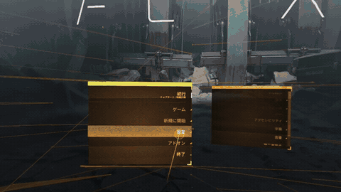
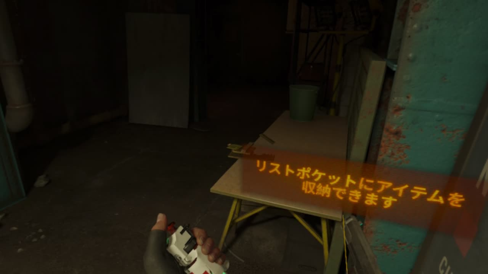

# VeRantyx（日本語）

Apple シリコンの Mac で PC VR ゲームを描画し、Apple Vision Pro へ HEVC で配信して遊ぶためのプロジェクトです。
手の位置は Vision Pro のハンドトラッキング、ボタン・スティック・トリガーはジョイコンから取り、トラッキング付きの
VR コントローラーは要りません。ゲームの動かし方が違う3つの版があります。

| 版 | ゲームの動かし方 | 状態 |
|---|---|---|
| vxrt版 | Windows 版のゲームと本物の Windows 版 SteamVR を、このリポジトリで一から書いた Windows ランタイム VXRuntime で動かす（Wine なし、Direct3D 11 → Metal） | 最新（2026-10-12〜14）。ヘッドセットでレベルをまたいでプレイ済み。M1 Max で 3K プリセット60fps。The Lab と Google Earth VR も動作 |
| ネイティブ版 | Valve の Linux ARM64 版 Alyx を、改造した Klepton と自作の glibc 層・OpenVR ランタイムで macOS 上でそのまま動かす | 2026-10-11。60fps、20分以上プレイ |
| Wine版 | Windows 版のゲームと SteamVR を Wine 11 + DXVK → MoltenVK で動かす | 2026-10-10 から安定。約30fps |



[](https://youtu.be/qF09ETv1TpU)

*vxrt版、2026-10-14 の録画から52秒: メインメニュー、隔離区域（a2_quarantine_entrance）、レベル切り替え後の
a2_pistol でのピストル、手と指、リストポケット、リロード。3K プリセット（片目1440×1620）、3404×1372 の HEVC Main10・
40Mbps、M1 Max。既知の問題は下の「vxrt版の状態と制約」にあります。無編集の全編（約4分）: https://youtu.be/qF09ETv1TpU *

以下の「このMacで確認した状態」より後の節は、主に Wine 版を作っていた時期（2026-09〜10-10）の記録です。

## vxrt版（VXRuntime）

### vxrtとは

VXRuntime（略称vxrt、[`VXRuntime/`](../VXRuntime/)）は、Apple シリコンの Mac 向けにゼロから書いた
Windows 互換レイヤーです。Windows のプログラム（PE ファイル）を読み込み、そのプログラムが呼ぶ Windows API を
macOS の上に直接実装して渡します。ファイル、レジストリ、スレッドと同期、例外、AppKit 上のウィンドウと入力、
ソケット、COM、Core Audio 上の音声、そして Metal 上の Direct3D 11 / DXGI です。これにより、Half-Life: Alyx の
Windows 版と本物の Windows 版 SteamVR（vrserver、vrcompositor、VeRantyx ドライバー）が Wine なしで Mac 上で動き、
ゲームは macOS でサインイン済みの Steam クライアントにつながります。

Wine のコードは使っていません。ただし、2026-10-12〜10-23 の版（mac-v0.1.0、mac-v0.2.0 を含む）には、Wine に由来する
x64 例外アンワインド処理が約 120 行含まれていました。AI エージェントが Wine のコードを再現して書いたもので、監査で
見つけ、Microsoft の資料だけからクリーンルームで書き直して置き換えました。その部分は MIT ではなく LGPL-2.1 以降で、
Wine の著作権表示とともに [THIRD_PARTY_NOTICES.md](../THIRD_PARTY_NOTICES.md) に記載しています。

2026-10-12 に始めました。理由は2つです。Wine 版では Wine 自体がボトルネックで（wineserver、Steam の Chromium、
二重のグラフィックス変換がすべて CPU に載り、約30fps で CPU 律速）、また Wine の設計が Apple の D3DMetal を
使えなくしていたためです。vxrt は Windows 版をそのまま動かすので、Linux ARM64 版があるゲーム（SteamVR タイトルでは
Steam Frame 向けに作られた Alyx だけ）に縛られません。

### どのように組まれているか

```
 Windows のプロセス1つ = macOS の x86-64 プロセス1つ（Rosetta 2 がプログラムとランタイムをまとめて変換）
 ┌──────────────────────────────────────────────────────────────────────┐
 │ hlvr.exe、vrcompositor.exe など（無改造の Windows PE コード）         │
 │   │ Windows の関数を直接呼ぶ（ms_abi）。Unix 側との境界はない         │
 │   ▼                                                                  │
 │ vxrt: PE ローダー・kernel32/ntdll・SEH と C++ 例外・ファイル/レジストリ │
 │       AppKit/Core Graphics 上の user32/gdi・ws2_32・COM・WASAPI       │
 │       Metal 上の Direct3D 11/DXGI（DXBC → Metal Shading Language）    │
 │       プロセス間の共有テクスチャ（IOSurface + keyed mutex）          │
 │       Steam ブリッジ → Mac の Steam クライアントの steamclient.dylib   │
 └──────────────────────────────────────────────────────────────────────┘
```

- **Unix 側がない**: Wine では Windows API の呼び出しが PE の DLL から別の Unix 側へ渡り、プロセス間で共有する
  カーネルオブジェクトは wineserver を通ります。vxrt では Windows API は Windows の呼び出し規約を持つネイティブの
  Mach-O コードで、プログラムが直接呼びます。カーネルオブジェクトはプロセス内にあり、他のプロセスが必要とする
  名前付きのものだけを共有メモリーに置きます。
- **スレッド状態は macOS のまま**: `gs` は macOS のスレッド固有データのままにし、TEB と TLS 配列をその2つの
  スロットに書きます。Windows のコード、ランタイム、Metal が何も切り替えずに同じスレッドを使えます。
- **グラフィックスは Metal へ直接**: Direct3D 11 の呼び出しは Metal の呼び出しになり、シェーダーは DXBC から
  Metal Shading Language へ一度だけ翻訳します（バックグラウンドで、Metal がキャッシュ）。Wine 版は
  D3D11 → Vulkan（DXVK）→ Metal（MoltenVK）でした。ジオメトリシェーダーはコンピュートカーネルで実行し、
  ストリーム出力（Unity のスキニング）も同様です。ゲーム・コンポジタ・ドライバー間の共有テクスチャは keyed mutex 付きの IOSurface なので、SteamVR のコンポジタが
  ゲームのフレームをそのまま受け取れます（Wine では開けませんでした）。
- **Windows 版 Steam なし**: ゲームの `steamclient64.dll` は組み込みで、すべての Steam インターフェースを
  サインイン済みの Mac の Steam クライアントへ転送します（インターフェースのメソッドごとの ms_abi → System V
  スタブ）。Windows の Steam も Chromium も動かしません。
- **実行時にコードを作らない**: メソッド表と呼び出しスタブは事前生成かアセンブリです。Valve と Microsoft の
  ファイルは利用者自身のインストールから使い、配布しません。
- **マイルストーン単位で構築**: 各段階が「無改造で動くべき小さな Windows プログラム」です（`make check`、
  約25本のテスト）。PE ローダーと kernel32 → スレッドと例外 → ファイルと DLL → AppKit 上のウィンドウ →
  COM・I/O 完了ポート・MSVC の C++ 例外 → Metal 上の Direct3D 11 → コンピュート・入力・音声 → プロセスと
  共有テクスチャ（SteamVR）→ Steam ブリッジ（Alyx）→ ジオメトリシェーダー → 3K/10ビット対応 → Unity の
  ゲーム（The Lab）→ ヘッドセットでのプレイ（セーブ、レベル切り替え、マルチサンプリング）。C と Objective-C で
  約31,000行、3日間（2026-10-12〜14）で Claude Code の Claude Opus 5.5 と書きました。設計と
  各マイルストーンの詳細は [VXRuntime/README.md](../VXRuntime/README.md) にあります。

### Wine版・ネイティブ版との比較

Half-Life: Alyx、MacBook Pro M1 Max、各版のログでの計測です。

| | Wine版 | ネイティブ版 | vxrt版 |
|---|---|---|---|
| ゲームのビルド | Windows（x86-64） | Linux ARM64（Steam Frame 向け） | Windows（x86-64） |
| CPU のコード | Rosetta 2 + Wine | ネイティブ ARM64（変換なし） | Rosetta 2、Wine なし |
| VR ランタイム | Wine 上の本物の SteamVR | 自作の OpenVR ランタイム | vxrt 上の本物の SteamVR |
| グラフィックス | D3D11 → DXVK → Vulkan → MoltenVK → Metal | Vulkan → MoltenVK → Metal | D3D11 → Metal（自作の翻訳） |
| Steam | Wine 上の Windows 版 Steam + Chromium | Mac の Steam | Mac の Steam（ブリッジ） |
| ゲーム中・標準サイズ | 約30fps（CPU 律速、SteamVR 倍率0.7） | 60fps、片目1298×1056 | 45〜57fps、片目約840×940 |
| 大きいサイズ | — | 片目1982×1536で約39fps、片目約3Kで約20fps | 3K: 片目1440×1620で60fps、配信も60fps（HEVC Main10、約470万画素）。2.5K: 片目2560×2880（2× MSAA）で50〜60fps。max: 片目3200×3600で16〜21fps |
| 他の Windows VR ゲーム | 可能（Wine） | 不可（Linux ARM64 版が必要） | The Lab（タイトル画面で53〜58fps）と Google Earth VR が動作。Bigscreen はまだ起動しない |
| ヘッドセットでのプレイ | 済み | 済み（20分以上） | 済み（2026-10-14、3K、レベル切り替えを含む） |

まとめると、ネイティブ版は CPU 変換がないので最速ですが、Valve が ARM64 版の Alyx を作ったから成り立つ方法です。
Wine 版はどの Windows ゲームも動かせますが、Wine と二重のグラフィックス変換のコストを払います。vxrt は
Windows 版と本物の SteamVR を保ったまま Wine を取り除き、すべての呼び出しまで自分たちで最適化できる版です。
研究段階のプロジェクトで、Direct3D 12、Vulkan、テッセレーションはまだなく、試したのは1台の Mac で4本のゲームです。

### vxrt版の起動

Wine も Windows 版 Steam も要りません。自分の Steam アカウントで1回セットアップします:

```bash
scripts/setup_vxrt.sh <Steamのログイン名> 546560 348250   # ビルド、SteamVR・Half-Life: Alyx・Google Earth VR（steamcmd）
scripts/setup_vxrt.sh --import "<既存の Steam ライブラリ>"  # または手元のアプリを APFS のクローンで取り込む（ダウンロードなし）
```

SteamVR とゲームは専用の Steam ライブラリ `~/Verantyx_VR_Drive/vxrt_steam` に入ります（`tools/vxrt_steam.py fetch|import|status`）。Microsoft のランタイム DLL（msvcp140、vcruntime140、msvcp100 など）は、あなたの SteamVR やゲームに同梱された再頒布パッケージ（`_CommonRedist/vcredist/*/VC_redist.x64.exe`、DirectX の cab）を実行せずに開いて取り出し、`~/Verantyx_VR_Drive/vxrt_redist` に置きます（`tools/vxrt_redist.py`）。Valve と Microsoft のファイルはリポジトリにも含まず、リポジトリからダウンロードもしません。Wine 版をセットアップした Mac もそのまま動きます: `vxrt_steam` に SteamVR がない間だけ Wine 版の prefix を読みます（書き込みはしません）。`VXRT_NO_WINE=1` で prefix を一切使わないようにできます。そのうえで、Mac の Steam にサインインして:

```bash
scripts/launch_vxrt_alyx.sh                      # vxrt 上の SteamVR + エンコーダー + Half-Life: Alyx
VXRT_VR_QUALITY=3k scripts/launch_vxrt_alyx.sh   # 片目1440×1620、2880×1620の10ビットHEVC・40Mbps、60fps
VXRT_VR_QUALITY=2.5k scripts/launch_vxrt_alyx.sh # 片目2560×2880で描画（2× MSAA）、配信は同じ、50〜60fps
VXRT_VR_QUALITY=max scripts/launch_vxrt_alyx.sh  # 片目3200×3600（Vision Pro の片目の画素数）、3840×2160配信、16〜21fps
```

ほかの SteamVR ゲーム: `scripts/launch_vxrt_game.sh "<ゲームの .exe>"`（The Lab と Google Earth VR は動作。多くのゲームはまだ VXRuntime にない Windows の関数が必要です）。ゲームごとの状態は [games/](../games/) にあります。

### vxrt版の状態と制約

MacBook Pro（M1 Max）、2026-10-14 時点:

- **Half-Life: Alyx**: ハンドトラッキングとジョイコンでヘッドセットでプレイでき、レベル切り替えとセーブも動きます（2026-10-14 の録画は a2_quarantine_entrance から a2_pistol へ進んでいます）。ハーネスでの計測は、3K プリセットでチャプター1が60.0fps、メニューが54〜59fps。
- **緑色に光る問題**: 奥の柵、植物の影、ペットボトルなど一部の表面が、ヘッドセットで緑色に光ったりにじんだりします。原因はまだ分かっていません（配信のパケット落ちで次のキーフレームまで緑になるのか、シェーダーの翻訳の問題か）。切り分け中です。
- **Wi-Fi**: 速い回線が必要です。2.4GHz ではカクつきと崩れが出ます。5GHz・80MHz 幅でかなり改善します。
- **max プリセット**: 16〜21fps（3K は60fpsを保ちます）。
- **初回起動**: 数千のシェーダーのコンパイルに数分かかります。2回目からは Metal のキャッシュを使います。
- **セーブ**: 2026-10-14（コミット 8d10cfb）より前のセーブにはレベルの状態が入っていません。チャプターを最初から始めてください。
- **セットアップ**（Wine なし、`scripts/setup_vxrt.sh`）: 2026-10-15 に `VXRT_NO_WINE=1`（prefix を一切使わない）でハーネスで確認。Alyx チャプター1 3K 60.0fps（20261015T005456Z-alyx-chapter-3k）、Google Earth VR 57.4fps（20261015T005918Z-earth-start）、The Lab 54.8fps（20261015T010214Z-thelab-title）。SteamVR とゲームは取り込み、DLL は SteamVR の再頒布パッケージから。steamcmd でのダウンロード経路そのものは、サインインが必要なのでここでは実行していません。
- 試した Mac は1台です。Direct3D 12、Vulkan、テッセレーションは未対応で、アンチチートは回避しません。

### AI コーディングツールでの最適化・ゲーム対応

このリポジトリを AI コーディングツールで開き、コマンドを使います。Claude Code、Codex、Gemini CLI、Cursor で同じコマンドです。

```
/vxrt-games              # 入っているゲーム、動作状況、最新の計測
/vxrt-support thelab     # 動くようにする: 計測 → VXRuntime を直す → 実行で確かめる
/vxrt-tune alyx          # 設定だけでこの Mac 向けに調整: 交互の計測 → 起動コマンド
/vxrt-playtest alyx      # ヘッドセットで遊んでもらい、うまくいかない場所を記録して読み返す
/vxrt-issue earth        # それでも動かない: 証拠から issue の下書き（投稿はあなただけ）
```

**「動く」の基準**: ハーネスの各実行は到達した段階を報告します。`starts`（起動）→ `connects`（SteamVR につながる）→ `draws`（真っ黒でない映像）→ `runs`（場面の最後まで動く）→ `controls`（SteamVR がコントローラーの割り当てを読み込んだ）。最後の段階 `playable`（遊べる）は人だけが決めます。プレイテスト `tools/vxrt_playtest.py <ゲーム>` は、いつもどおりゲームを起動し、遊んでいる間、頭と手の追跡、トリガー・グリップ・ボタン・スティック、fps を毎秒記録します。うまくいかない場面で両スティックを1秒押し込む（またはターミナルで Enter）と、そのときの画面とゲームのログを残します。最後に短いチェックリスト（映像、頭、手、ボタン、移動、メニュー、音）に答えます。映像・頭・手・ボタン・移動がすべて「はい」、コントローラーの入力あり、クラッシュなし、10分以上で playable です。プロファイルが `works` になるのはこのプレイテストの後（`--apply`）だけで、見つかった問題が `/vxrt-support` の次の作業になります。

ゲームはプロファイルのキー、Steam のアプリ ID、フォルダか .exe で指定します。各ツールには、コマンド・vxrt の MCP サーバー・規則（[AGENTS.md](../AGENTS.md)）が、そのツールが読む形（`.claude/`、`.codex/config.toml`、`.gemini/` と `GEMINI.md`、`.cursor/`）で入っています。どれも `tools/vxrt_agents.py` が1つの元（`.agents/commands/`、`.mcp.json`、AGENTS.md）から書き出したものです。手順書は `.agents/skills/` にあります。Codex はプロジェクトを信頼済みにすると `.codex/config.toml` を読みます。

コマンドは `tools/vxrt_doctor.py` が書く「課題の説明」から始まります。doctor はゲームを実行せずに中身（実行ファイルと DLL、エンジン、グラフィックス API、アンチチート、VXRuntime にまだない Windows の関数）と前回のログを調べ、目標、完了の条件（ハーネスで確かめられること）、JSON の事実、先に使うツール（ツールごとの呼び方: `--agent claude|codex|gemini|cursor`）、規則、止まるとき、報告の形を書きます。スクリプトは何も外部に送信しません。自分で貼る場合:

```bash
tools/vxrt_doctor.py thelab --goal support --agent codex --copy   # 動くようにする（VXRuntime を変更）
tools/vxrt_doctor.py alyx --goal tune --copy                      # 設定だけでこの Mac 向けに調整
tools/vxrt_doctor.py earth --facts                                # 事実だけを JSON で
```

アンチチートのあるゲームは検出して注意を出し、回避はしません。

**自動調整**: `tools/vxrt_tune.py <ゲーム>` は、ヘッドセットなしで、その Mac で表示 Hz を保てる一番よい画質を探します。ハーネスで、片目の画素数の少ない設定から多い設定へ順に試し（標準、3K、描画倍率2.4の3K、2.5K、max。ゲームのプロファイルに専用の段を書くこともできます）、表示 Hz の95%を保てなくなったところで止まり、保てた一番高い設定を交互の実行でもう一度確かめます。`--plan` で段と時間の見込みを先に表示します（30分以上かかり、その間は遊べません）。`--apply` で確かめた設定をその Mac 用としてプロファイルに書き、`tools/vxrt_tune.py --show <ゲーム>`（または VXRT Studio の画質の「この Mac に調整済み」）で起動コマンドが出ます。`/vxrt-tune <ゲーム>` なら、AI ツールがこれを実行し（MCP の `tune_game` / `read_tune`）、run ID 付きで報告します。

同じことを画面で: `python3 tools/vxrt_studio.py` でブラウザに VXRT Studio が開きます。VXRuntime 用に入っているゲーム（`~/Verantyx_VR_Drive/vxrt_steam`、`vxrt_library`、あれば Wine 版のライブラリ）の一覧、動作状況、前回の実行で見つかった問題を表示し、プロンプト（調整／動くようにする）と起動コマンドをボタンでコピーできます。「AIに任せる」を押すと、ターミナルで Claude Code か Codex（入っていれば Gemini CLI と Cursor のエージェントも。あなたのログインのまま）がこのリポジトリで起動し、プロンプトと vxrt の MCP サーバーを受け取って、ゲームの起動・計測から修正まで自分で進めます。127.0.0.1 だけで動き、AI の起動にはページ固有の合言葉が必要です（他のサイトからは起動できません）。

AI はハーネス `tools/vxrt_run.py`（MCP サーバー `tools/vxrt_mcp.py` としても使え、Claude Code には `.mcp.json` で登録）で計測します。ゲームを専用のフォルダで、仮想のヘッドセットで動かし、公平に測れない実行（プレイ中、SteamVR が起動中、VR がオフなど）は理由付きで拒否します。見たことは証拠として `runs/` に書きます（観測値とその元ファイルのハッシュ、凍結した基準値から導いた結論、推測、不明点）。記録はハッシュでつないだ台帳に残ります。`make -C VXRuntime vr-check` で基準値のあるゲームをすべて確かめます。AI 向けの手順書は `.agents/skills/` にあります。

ゲームごとの知識は `games/<Steam のアプリ ID>.json` にあります（起動方法、計測する場面、基準値、既知の問題。[games/README.md](../games/README.md)）。誰でも、ハーネスの結果を証拠にして、プルリクエストで追加・更新できます。それでも動かないゲームは、`tools/vxrt_issue.py draft <ゲーム>`（MCP では `prepare_issue`）で、証拠から個人情報を除いた issue の下書きを作れます。投稿は `tools/vxrt_issue.py submit` が内容を見せて確認してから行います。

初回はゲームのシェーダーのコンパイルに数分かかります。10ビット配信には最新の Vision Pro アプリが必要です
（`scripts/deploy_vision_pro_app.sh`）。

## このMacで確認した状態

- Half-Life: AlyxのWindows版`hlvr.exe`と約73GBのゲームデータが`~/Verantyx_VR_Drive/SteamVR_Prefix`内にあります。再ダウンロードは不要です。
- Windows Steamの`steam.exe`とSteamVR本体は同じprefixにあります。SSDから転送された`~/Verantyx_VR_Drive/Beer/wine/WineStaging.app`のWine 11.9でWindows Steamを起動し、Steam UIの表示とサインインをテスト用クローンで確認しました。
- `~/Verantyx_VR_Drive/wine_wrapper`はGame Porting Toolkit 1.1のWine 7.7を指していました。`VRDriver/wine_launcher.sh`はWine 11.9を優先し、見つからない場合のみ従来の独自wrapperへフォールバックします。
- 認証済みSteamセッションは`~/Verantyx_VR_Drive/SteamVR_Prefix_Wine11_Test`というAPFSクローン上で確認しています。本番PrefixのSteamファイルは変更していません。
- 転送済みSteamVR本体は`steamapps/common/SteamVR`にあり、Steamがインストール済みとして認識するappmanifestを所定の`steamapps`直下に登録しました。
- リポジトリのVerantyx HMDドライバーをWindows x64 DLLとしてビルドし、登録済みフォルダーとSteamVR同梱の同名ドライバーへ配置しました。古いSteamVRログで同梱側が優先されることを確認したため、元DLLは両方の場所で`.mbp-avp-vr-original`として保存します。
- Vision Proには修正版をインストールできていますが、Macからのリモート起動はCoreDeviceのタイムアウトで失敗するため、ヘッドセット上で手動起動が必要です。現時点ではSteamVRと配信エンコーダーが起動し、Vision Proから最初の姿勢パケットが届くのを待っています。
- Windows SteamとAlyxのファイルはローカルにあります。サインイン情報はリポジトリに保存しません。

これらの実行ファイル、Steamライブラリ、ゲームデータ、カスタムWindows実行環境はGitには含まれません。

## 実装

- `VRDriver/src/driver_verantyx.cpp`はSteamVRの仮想HMDとして頭部・コントローラー姿勢を登録し、SteamVRの共有D3D11フレームを読み出して共有メモリーへコピーします。Alyxの直接キャプチャが有効な間は、このフォールバック取得を止めます。専用スレッドがVision Proの姿勢を受け取った直後にSteamVRへ渡し、手の速度（投げる動作とSteamVRの予測に使用）を推定します。HMDへ渡した姿勢はIDつきで共有メモリーへ記録します。
- `VRDriver/src/openvr_capture_proxy.cpp`はAlyxの左右`IVRCompositor::Submit`を捕捉し、typeless RGBAテクスチャをステレオ画像へ読み出します。`WaitGetPoses`がゲームへ返した頭部姿勢を上の記録と照合し、各フレームに「描画に使われた姿勢のID」を付けます。GPUコピーは次の`WaitGetPoses`の時点で回収し、1フレーム分の遅延を減らします。
- `MacEncoder/HardwareEncoder.swift`は共有フレームをVideoToolboxでHEVCに変換し、Bonjourで見つけたVision ProへUDP送信します。両目で約300万画素（Vision Proの視野では2732×1094）、30 Mbpsが既定です。SteamVRのレンダー倍率は既定0.5です。出力幅・高さは`VERANTYX_STREAM_WIDTH`と`VERANTYX_STREAM_HEIGHT`で変更できます。キーフレームは接続時・欠落時の要求と3秒ごとの保険だけで送ります。
- `VisionProClient/VisionSpatialTools`はBonjourでMacを探し、UDPでHEVCを受信・再構成して、VideoToolboxで専用キュー上にデコードします。姿勢は没入表示の描画ループで毎フレーム1回、表示時刻より先に予測して送ります。戻ってきたフレームには、その姿勢のARKitアンカーをそのまま付け、visionOSが表示時点の頭の向きへ再投影します。手の関節からOculus Touch（Rift S）を握ったときのコントローラー姿勢を計算し、ジェスチャーをトリガー、グリップ、ボタン、スティックへ変換します。
- `scripts/install_openvr_driver.sh`は外部登録先とSteamVR同梱先の両方へ同じDLLを配置します。SteamVRが同梱側を優先する場合も更新版が使われ、置き換え前のDLLは隣にバックアップされます。
- `scripts/build_steamwebhelper_shim.sh`と`install_steamwebhelper_shim.sh`は、WineでCEFが初期化できない場合に備え、Steam WebHelperへ`--disable-gpu --single-process`を付けるWindows x64 shimを作成・導入します。元のWebHelperは`steamwebhelper_real.exe`に保存します。
- `scripts/launch_vision_pro_vr.sh`は必要なshimを導入し、WebHelper初期化とSteamの認証状態を確認してからSteamVR（App ID `250820`）を起動します。Verantyx HMDの有効化後にAlyx（App ID `546560`）を起動します。Steamの起動をバックグラウンド化し、Steamが終了まで制御を返さず後続処理が止まるのを防ぎます。

以前のテストではSteamVR、Alyx起動、Alyxの左右テクスチャ取得まで確認しています。今回の起動ではSteamVR設定を0.5にして再起動し、AlyxはVision Proの姿勢パケット到着後に起動するよう待機しています。SteamVR自身へのAlyxテクスチャ提出は`TextureUsesUnsupportedFormat`になりますが、配信用フレームは別経路で取得します。

## 滑らかさの修正（2026-10-09）

カクつきの主な原因と対策です。

- Vision Proの深度を「最も手前」で塗っていた: Compositor Servicesはreverse-Z（1が手前、0が奥）で、深度を使って再投影します。映像全体がニアクリップ面（すぐ目の前）にあると扱われ、頭が少し動くだけで映像が大きくずれる状態でした。深度を0（遠方）にし、回転方向の再投影だけが効くようにしました。
- フレームと姿勢の対応がずれていた: 以前は`Submit`時点の最新姿勢をフレームに付けていましたが、ゲームはそれより前の`WaitGetPoses`の姿勢で描画しています。描画時間ぶんのずれが毎フレーム変わり、頭を動かすと揺れていました。今は描画に使われた姿勢IDを正確に照合します。
- 0.5秒ごとの強制キーフレーム: 通常フレームの数倍の大きさのIDRを毎秒2回送っていたため、周期的に引っかかっていました。合成映像の計測では10秒間のキーフレームが38回から4回に減りました。
- 仮想ディスプレイのvsyncがずれていた: `WaitForPresent`が毎回固定で11ms待ち、`GetTimeSinceLastVsync`の時計と同期していませんでした。Alyxが`WaitGetPoses`から解放される間隔がばらついていたため、同じ仮想vsyncの境界まで待つように直しました。
- 姿勢送信の揺らぎ: Vision ProではUI処理と同じメインスレッドのタイマーで送り、Mac側ではSteamVRの`RunFrame`のタイミングでしか姿勢を渡していませんでした。今は表示と同じ周期で送り、ドライバーは到着直後に渡します。
- 視野（フラスタム）が合っていなかった: SteamVRはヘッドセット接続前の起動時に視野を1回だけ読み、8:9の仮の値で固定していました。Vision Proの実際の片目視野は外側60°・内側45°・下50°・上45°と広く非対称で、仮の画像を引き伸ばして表示していたため、片側が黒くなり大きさもずれていました。ドライバーは実際の視野を`C:\vr_verantyx_tangents.txt`へ保存して次回起動から使い、使用中の視野をVision Proへ送ります。Vision Proは、ゲームが描画した視野の角度どおりに画像を配置します。
- エンコーダー: RGBA→BGRA変換をSIMD化し、送信ペーシングを24 Mbpsから48 Mbpsに上げました。合成フレームでの取り込みから受信までの遅延は16.8msから12.6msになりました。

## 手の入力（Half-Life: Alyx）

Alyxの入力が効かなかった原因と対策です。

- HMDのメーカー名が`Verantyx`だったため、手を見失うたびにAlyxが「Unknown HMD manufacturer - falling back to gamepad」でゲームパッド操作へ切り替えていました。エミュレートしているTouchに合わせ、`Oculus`として報告します（`VERANTYX_HMD_MANUFACTURER`で変更可能）。
- ARKitの手首アンカーの向きを、そのままコントローラーの向きとして使っていました。今はOpenXRのグリップ姿勢を手の関節から求め、SteamVR同梱のRift Sレンダーモデル（`openxr_grip`）の位置関係から、実際にTouchを握ったときのraw姿勢へ変換します。
- グリップの閾値: Alyxはグリップとトリガーの押下を0.75で判定しますが、以前の指の曲がり具合の式では、普通に握っても0.75に届かないことがありました。今は指の長さで正規化し、ヒステリシスつきで判定します。
- 握るとスティックが動いていた: 物をつかんで手を動かすと、テレポートやターンが勝手に起きていました。また強く握るとスティック押し込み（武器選択）になっていました。スティックは専用ジェスチャーに分けました。
- 手の速度を送っていなかったため、物を投げられませんでした。

### ジョイコン（推奨）

手の位置はハンドトラッキング、ボタン・スティック・トリガーはジョイコンから取ります。手がカメラの視界から外れてもボタンは効き、手の位置は3秒間保持されます。

1. Vision Proの「設定 > Bluetooth」で左右のジョイコンをペアリングします（側面の小さな同期ボタンを長押し）。
2. 左右は**まとめずに別々のまま**使うのを推奨します。1本ずつが独立したコントローラーになり、両手にジャイロ・加速度センサーが付きます（向きはジャイロとハンドトラッキングを相補フィルタで合成、手首のフリックでグラビティグローブ、手が見えない間は慣性で補間）。L・R同時押しで1つにまとめる方式も動きますが、センサーが1系統（右手）になります。visionOSは1本のジョイコンを「横持ち」として報告するため、アプリ側でスティックとセンサーの軸を縦持ちに戻しています。
3. ジョイコンは片手に1本ずつ、Touchコントローラーのように縦に握ります。

| ジョイコン | Touchの入力 |
|---|---|
| ZL / ZR | トリガー |
| L / R | グリップ（つかむ） |
| スティック・押し込み | スティック・スティック押し込み |
| 右 A・B | A |
| 右 X・Y | B |
| 左 ↓・← | X |
| 左 ↑・→ | Y |
| − / ＋ | メニュー（左のシステムボタン） |

手がカメラから見えなくなっても、ジョイコン使用中は頭に対する最後の位置に手を置いたままにします（以前は3秒で手を消していたため、ゲーム内で手が飛んでいました）。ジョイコンを握った手は一部が隠れて位置が揺れるので、軽く平滑化しています。ジョイコンのモーションセンサー（ジャイロ・加速度）が取れる場合、手が見えない間はジャイロで手の向きを回し、加速度で位置を動かします（加速度の積分は1秒ほどで流れるため、強い減衰と50cmの上限つき）。まとめた左右のジョイコンはモーションが1系統しか取れないため右手に適用します。手が見えている間も、ジャイロの角速度と加速度計の瞬間的な速度を手の速度に合わせてSteamVRへ送ります。Alyxのグラビティグローブは「手首を素早く振る」動きを手の速度で検出するため、カメラの位置差分だけでは鈍って反応しませんでした。アプリ画面の「コントローラー」欄に、取れたセンサーの種類が表示されます。ジョイコン以外の一般的なゲームパッド（DualSenseなど）も、左右に分けて同じように使えます。

### コントローラーについて

必要なのはジョイコン（または手だけ）です。トラッキング付きの VR コントローラーは不要です。Vision Pro 上でネイティブに動く Alyx の移植（Glovebox）は PS VR2 Sense コントローラーが必須ですが、これは日本では販売されていません（2026 年 10 月時点）。将来入手できるようになれば、visionOS の 6DoF アクセサリトラッキングで手の位置をコントローラーの位置に置き換える対応を足せます。

### 合体ジョイコンを左手だけで持つ（既定）

左右を合体したジョイコンを左手だけで持ち、右手を自由にする方式です（アプリ画面の「合体したジョイコンを左手だけで持つ」スイッチ、既定でオン。倒した向きは「片手持ちゲームパッドの向き」で選択）。右ジョイコンのZR・Rがトリガーとグリップ（左ジョイコンのZL・Lは無視）、右ジョイコンのスティックが移動（テレポート）、左ジョイコンのスティックが視点の回転、矢印キーがX/Y、A/B/X/Yが右Touchのボタンです。右手のトリガーとグリップはジェスチャーのままなので、右手で掴む・撃つ・グラビティグローブができます。左スティック（移動）を倒している間はテレポートの方向と距離がスティックに従います。ジョイコンを持つ左手はカメラで追跡しません（コントローラーを握った手は追跡が不安定で、ボタン以外は不要なため）。頭の横下の固定位置に置き、頭の向きに合わせて回し、テレポートの照準はスティックで行います。アプリ画面には右手の認識結果（開いた手／グー＝グリップ／人差し指ピンチ＝トリガー／他のピンチ）が表示されます。

### プロコン（片手持ち）

Nintendo Switch Proコントローラー（他のゲームパッドも同様）は左手に1つだけ持って使えます。親指でスティックと十字キーに届くよう横に倒して持ち、アプリ画面の「片手持ちゲームパッドの向き」で縦持ち／左に倒す／右に倒すを選ぶと、スティックの軸がそれに合わせて回転します。左半分（ZL・L・左スティック・十字キー・−）が左Touch、右スティックとA/B/X/Yが右手の入力になり、右手のトリガーとグリップはジェスチャー（人差し指ピンチ・指の握り）のままなので、右手は自由に掴む・撃つ・グラビティグローブができます。左スティックを倒している間は左手の照準がスティックに従い、倒した方向（頭の向き基準）がテレポートの方向、倒し量が距離（浅いと近く、いっぱいで遠く）になります。

### ハンドジェスチャー（ジョイコンがないとき）

ジェスチャー（左右共通）:

| 操作 | Touchの入力 |
|---|---|
| 親指と人差し指でつまむ | トリガー |
| 中指・薬指・小指を握る | グリップ（つかむ） |
| 親指と薬指でつまむ | A / X |
| 親指と小指でつまむ | B / Y |
| 親指と中指でつまんだまま手を動かす | スティック |
| 左手: 親指と中指でつまむ（0.15秒） | スティックを前へ倒す（テレポート照準、離すと移動） |
| 右手: 親指と中指でつまんだまま0.45秒静止 | スティック押し込み（武器選択） |
| 両手を握って頭より上に1.5秒上げる | リセンター（位置と向きの再設定） |

グラビティグローブ（ジョイコンなし）: 開いた手を物に向け、中指〜小指を握って（グリップ）ロックし、手首を自分のほうへ素早く振って、握ったまま受け取ります。手の速度はハンドトラッキングだけから求めるので、速く振り、手をカメラの視野に入れたままにしてください（フリックのピークをそのまま送るよう速度の平滑化を変えました）。

没入表示中はアプリのウィンドウを閉じます。ゲーム用のピンチが「停止」ボタンなどに当たって没入表示が終わるのを防ぐためで、Digital Crownで没入表示を終えると戻ります。visionOSのシステムジェスチャー（手のひらを見てタップでホーム）をアプリから完全に無効にするAPIはないため、システム表示は隠していますが、意図的に操作すれば開きます。没入表示では現実の手を隠し、Alyxの手だけを表示します。手のひらを上に向けたときのvisionOSのホーム表示も抑えます。位置合わせの確認用に、アプリ画面の「現実の手も表示する」で現実の手を重ねて表示できます。手がカメラの視界から外れても0.8秒間は頭に対する位置とグリップを保つので、銃を下ろしたときや物を横へ運ぶときに落としません。

## 音声

Macのエンコーダーは、macOSのシステム音声タップ（Core Audio process tap）でMacの出力音声を取り込み、16-bit PCM（5msごとの「AUDI」パケット）としてVision Proへ送ります。送信中はMacのスピーカーを消音します（`VERANTYX_AUDIO_KEEP_MAC_SPEAKERS=1`で鳴らしたままにできます。`VERANTYX_AUDIO=0`で無効）。初回は「システム音声の録音」の許可を求められるので、許可してからスクリプトを実行し直してください。Vision Pro側はAVAudioEngineで再生します。Wi-Fiでは5msのパケットが映像フレームごとにまとめて届くため、約80msためてから再生を始め、欠落したパケットは無音で埋めて拍子を保ち、約250ms以上たまったぶんは捨てます。

## Alyxの起動について

- SteamはAlyxを自分で起動することがあり（Steam起動の約40秒後や、Alyx終了の約40秒後）、その間はスクリプトの起動要求が無視されます。そこで、9月30日に1時間動いた起動オプション（`-vr -nowindow -novid -console -vconsole -condebug -dx11`）を、AlyxのSteam起動オプションとして`scripts/set_alyx_launch_options.sh`で保存します。Steamが動いていないときだけ書き込み、元の設定は`localconfig.vdf.mbp-avp-vr-original`に残します。
- `-noautofidelity -forcefidelitylevel 0 +engine_no_focus_sleep 0`を付けると、Alyxは解像度設定の初期化直後に終了コード1で落ちていたため、使いません。解像度はSteamVRの描画倍率（既定0.35）で抑えます。AlyxはこのMacでは自動で最上位の画質段階を選ぶため、最上位でも片目約1150×920になります。

## 調整用の環境変数

起動スクリプトの実行時に指定します。

- `VERANTYX_RENDER_TARGET_SCALE`（既定0.7、0.2〜1.5）: SteamVRの描画倍率（面積比、SteamVRの「カスタム解像度」と同じ）。次回SteamVR起動時に反映されます。
- `VERANTYX_DISPLAY_HZ`（既定60）: 仮想ディスプレイのリフレッシュレート。SteamVRのコンポジターはこの周期で合成するので、下げるほどMacのCPU負荷が減ります（このMacではゲームが18fps前後のため60で十分）。
- `VERANTYX_GPU_CONVERT=0`: 映像の縮小・色変換をCPU（vImage）で行います。既定ではMetalの計算シェーダーでGPUが行います（合成フレームの計測で、取り込み→送信が18.5msから14.2msに、エンコーダーのCPU使用率が約20%から約9%に下がりました）。
- `VERANTYX_BITRATE_MBPS`（既定30）、`VERANTYX_SEND_PACING_MBPS`（既定80）: HEVCビットレートとUDP送信速度。Wi-Fiでパケットが欠ける場合は送信速度を下げてください。
- `VERANTYX_KEYFRAME_INTERVAL`（既定3秒）: 保険用キーフレームの間隔。
- `VERANTYX_LOW_LATENCY_ENCODER=1`: VideoToolboxの低遅延レート制御。フレームサイズは揃いますが、このMacでは1フレームの符号化が8msから12msに増えたため既定ではオフです。

## 起動

0. Vision Proアプリを更新します（姿勢予測・ジェスチャー・深度の修正はアプリ側にあります）: `./scripts/deploy_vision_pro_app.sh`
1. Vision Proで「VeRantyx」を開き、「ステレオVRを開始」をタップします。初回プロンプトが出たらローカルネットワークと手のトラッキングを許可します。
2. Mac側で起動スクリプトを実行します。SteamVR起動後、Vision Proの姿勢パケットが届くまでAlyxは起動せずに待ちます。Windows Steamに未サインインならクライアントを開き、CEF画面の準備とサインインを待ってから続行します。
3. Vision Proアプリ画面でMac接続、受信fps、頭・手の追跡状態、左右のtrigger/grip/button値、「遅延」（姿勢を送ってから、その姿勢のフレームが表示されるまで）を確認します。

```bash
WINEPREFIX="$HOME/Verantyx_VR_Drive/SteamVR_Prefix_Wine11_Test" ./scripts/launch_vision_pro_vr.sh
```

SteamVRだけを起動して確認する場合:

```bash
WINEPREFIX="$HOME/Verantyx_VR_Drive/SteamVR_Prefix_Wine11_Test" STEAMVR_ONLY=1 ./scripts/launch_vision_pro_vr.sh
```

ログは`logs/`に出力します。SteamVR起動待ちは`STEAMVR_STARTUP_TIMEOUT=300`、WebHelper準備待ちは`STEAM_WEBHELPER_STARTUP_TIMEOUT=120`、サインイン待ちは`STEAM_LOGIN_TIMEOUT=900`のように変更できます。別のprefixやドライバーフォルダーを使う場合は`WINEPREFIX`、`VERANTYX_VR_DRIVE`、`VR_DRIVER_DIR`、`STEAMVR_DRIVER_DIR`を指定してください。

## ドライバーのビルド

```bash
./scripts/build_openvr_driver.sh
./scripts/install_openvr_driver.sh
```

このMacには`x86_64-w64-mingw32-g++`があるため、Windows x64用ドライバーを再ビルドできます。カスタムWindowsランチャーとruntimeはSSDから転送済みのものを利用します。リポジトリはそのruntimeを置き換えません。

## 確認状況と制約

- Windows x64ドライバーDLL、Steam WebHelper shim、Mac HEVCエンコーダーはコンパイルできます。
- テストクローンではWine 11.9でSteam UI表示とオンラインサインインを確認済みです。SteamVRの起動、ドライバー有効化、D3D11デバイス作成、Alyx起動、アプリの直接キャプチャ、VideoToolboxのHEVC出力まで確認しました。
- Vision Proアプリの修正版ビルドとインストールは成功していますが、`devicectl`からの起動はCoreDeviceタイムアウトで未確認です。手トラッキング権限を署名へ追加すると、現在の`iOS Team Provisioning Profile: *`に`com.apple.developer.arkit.hand-tracking`が含まれないとXcodeが拒否します。ARKitの許可結果、頭・手トラッキング、実機映像とゲーム内入力はヘッドセットで確認が必要です。資格情報をコマンドラインやリポジトリへ書き込みません。
- 2026-10-09の修正で確認済みなのは次の範囲です: ドライバーDLL・キャプチャproxyのビルド、Vision Proアプリのビルド（visionOS Simulator向け）、合成フレームと疑似ヘッドセットを使ったエンコーダーの送受信、姿勢照合の行列変換の単体テスト。ヘッドセットとAlyxを使った実機確認はまだです。手のコントローラー位置は計算上Rift Sの持ち方に合わせていますが、ずれる場合は実機で調整が必要です。
- 前回のSteamVRはクラッシュ後のセーフモードでVerantyxドライバーを読み込んでいませんでした（`blocked_by_safe_mode`）。起動スクリプトがこのブロックを解除し、セーフモードを無効にします。
- スクリプトは`rg`（ripgrep）を使わず、macOS標準の`grep -E`で動きます。このMacの`/opt/homebrew/bin`と`/usr/local/bin`には`rg`がなく、`rg`がPATHにない環境では以前のスクリプトはビルド確認やドライバー起動の検出に失敗していました。
- Windows用DLL（ドライバー、D3D11 proxy、キャプチャproxy、WebHelper shim）は、同じソースから同じバイト列になるようにビルドします（タイムスタンプなし、シンボル除去、固定の作業パス）。インストールは別ファイルに書いてから名前を差し替える方式で、内容が同じなら何もしません。以前は毎回内容の変わるDLLを、SteamVRが読み込み中のファイルへ上書きしていたため、SteamVRを使い回すと不安定になる可能性がありました。Alyxの実行中は、読み込み中のOpenVR DLLを差し替えません。

---

ライセンス: MIT © 2026 Ag3497120。例外は [THIRD_PARTY_NOTICES.md](../THIRD_PARTY_NOTICES.md) を参照してください（過去の版に含まれていた Wine 由来の LGPL のコード約 120 行を含む）。
